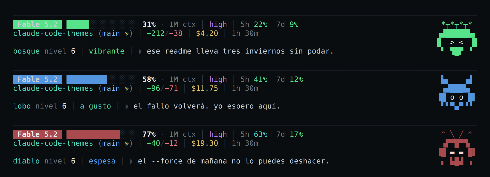
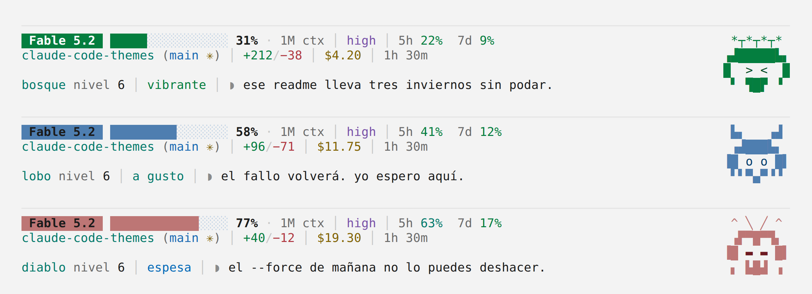
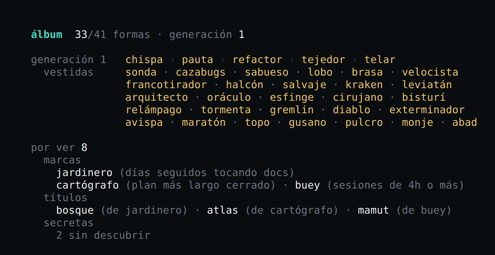
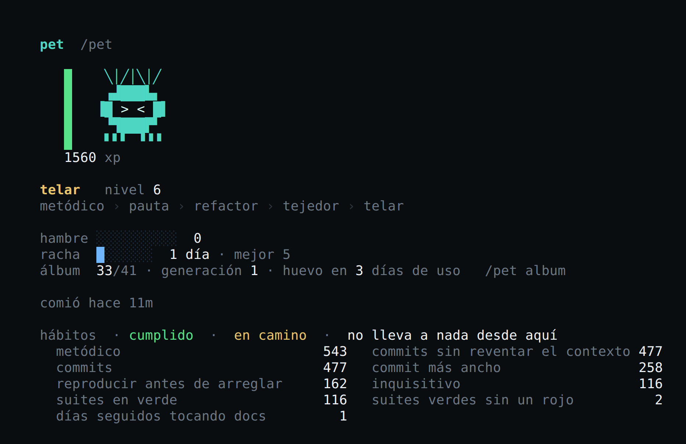

# claude-code-themes

Cuatro temas de color para [Claude Code](https://claude.com/claude-code) —uno claro— y una
**statusline** que ocupa el pie de la ventana: cuatro bandas de datos a la
izquierda y una mascota a la derecha que refleja el estado de la sesión y
**evoluciona según cómo trabajas** — 41 formas en un árbol de seis niveles, con
xp, hambre y racha.

Plugin instalable. El runtime es un binario de Go sin dependencias: ni `python3`,
ni `node`, ni `jq`. Cuesta 1,5 ms por refresco.



Tres sesiones abiertas a la vez sobre el mismo repo: cada una lleva la forma que pide
su trabajo y dice lo suyo. Con un tema claro en Claude Code, el pie le sigue:



## Las cuatro bandas

- **1 · el motor** — modelo, contexto, los dos límites, razonamiento y ritmo: lo
  que cambia cada turno. Las cuotas van pintadas con la misma escalera de color que
  la mascota, así que un `5h` al 95% sale en índigo aunque la ventana esté vacía.
- **2 · el trabajo** — repo, rama, diff, coste y el reloj de la sesión.
- **3 · dónde y con qué criterio** — la carpeta (solo la carpeta; si estás en la
  raíz del repo, desaparece) y el estilo de salida activo, **comprobado contra el
  disco** antes de pintarlo: el payload manda el nombre configurado, no el cargado.
- **4 · la mascota** — oficio, la marca entre corchetes, nivel, cómo está, la barra y
  el bocadillo. `cazabugs[sabueso]` se lee entero como un nombre: *un cazabugs, en
  su forma sabueso*.

Por debajo de **100 columnas** la banda 4 se queda solo con el oficio; por debajo de
**55**, la mascota desaparece.

El porqué de cada decisión está en [statusline.md](docs/design/statusline.md).

## La mascota

Nueve columnas. La silueta **y el color** los elige la evolución; los ojos, las
patas y el peldaño de la rampa los elige el estado. Cada rama tiene su tono y lo
mantiene en los siete estados, que es lo que permite distinguir 41 siluetas en las
filas que hay.

### Siete estados

Un solo número decide estado, ojos, patas y color: `context_window.used_percentage`.
Cambia **cuatro señales independientes**, en este orden — primero los ojos, luego el
paso, luego la cabeza se hunde, y al final la silueta se tumba. A un vistazo se
distingue *cansada* de *ahogada* sin leer la etiqueta.

| Uso | Etiqueta | Ojos | Cabeza | Patas |
| --- | --- | --- | --- | --- |
| ≤22% | fresca ✦ | `>` `<` | sí | anda |
| ≤45% | vibrante | `>` `<` | sí | anda |
| ≤63% | a gusto | `o` `o` | sí | anda |
| ≤78% | espesa | `▬` `▬` | sí | quieto |
| ≤89% | cansada | `_` `_` | **hundida** | quieto |
| <100% | ahogada | `x` `x` | hundida | quieto |
| 100% | k.o. | `x` `x` | hundida | **tumbado** |

Es **solo el contexto**, a propósito. Las cuotas de 5h y 7d son de la cuenta, no de
la sesión: metiéndolas en la cuenta, todas las ventanas abiertas leían el mismo
número y la mascota dejaba de hablar de la sesión en la que vive. Siguen en la banda
1, con número y color, pero sin cara. El razonamiento entero en
[vitals.md](docs/design/vitals.md).

### El árbol

La forma no la eliges: sale de cómo trabajas. Los commits y los `/compact` llevan
por la rama **metódica**, los tests y los planes por la **inquisitiva**, y trabajar
con el contexto arriba por la **impulsiva**.

```
        nivel 1        2            3          5              6
        chispa ─┬─ brasa ─┬─ maratón ──┬─ buey ────── mamut
                │         │            └─ topo ────── gusano
                │         ├─ salvaje ──┬─ gremlin ─── diablo
                │         │            └─ kraken ──── leviatán
                │         └─ velocista ┬─ francotirador ─ halcón
                │                      └─ relámpago ─ tormenta
                ├─ pauta ─┬─ pulcro ───┬─ jardinero ─ bosque
                │         │            └─ monje ───── abad
                │         └─ refactor ─┬─ cirujano ── bisturí
                │                      └─ tejedor ─── telar
                └─ sonda ─┬─ arquitecto┬─ cartógrafo ─ atlas
                          │            └─ oráculo ─── esfinge
                          └─ cazabugs ─┬─ exterminador ─ avispa
                                       └─ sabueso ──── lobo
```

1 raíz + 3 temperamentos + 7 oficios + 14 marcas + 14 títulos = **39**, más dos
secretas fuera del árbol: `fénix` y `quimera`. El nivel 4 no bifurca.

Cada fila del lienzo es una forma en los siete estados. **La marca de arriba y el
número de patas identifican la forma y no cambian nunca**; el estado rellena los
ojos, mueve el paso, aplana el cuerpo a partir de *cansada*, lo tumba en *k.o.* sin
perder la cuenta de patas, y baja el color por la rampa de esa rama.


Las marcas y los títulos heredan la rampa de su oficio —un sabueso es azul como el
cazabugs del que sale, y lo que los distingue es el cuerpo—, y por eso **diez rampas
bastan para 41 formas**. Todas salen de `internal/pet/testdata/ATLAS.json`, que está
en el repo y contra el que cuatro tests comparan el Go: los 41 nombres, las 10
rampas, los padres del árbol y las 287 siluetas fila a fila.

### Cómo come

| Evento | xp | Hambre | Freno |
| --- | --- | --- | --- |
| tests en verde | **+15** | −4 | una vez por hora, y solo si has cambiado algo |
| commit | **+12** | −3 | — |
| compact | **+8** | −3 | — |
| compact automático | **+8** | −3 | — (cuenta como trabajar al límite) |
| tarea del plan cerrada | **+6** | −1 | — |
| `/feed` | **+3** | −2 | uno cada cuatro horas |
| contexto al 100% | **−15** | — | rompe la racha |

Los niveles llegan a 200, 450, 700, 1000 y 1500 xp: una vida dura unos doce días de
uso normal.

**Cada etapa decide la siguiente.** Entre evolución y evolución, la mascota cuenta
qué hábitos has tenido, y al cruzar el nivel los usa para elegir rama, **una vez**.
Una semana de tests te vuelve cazabugs aunque lleves meses commiteando. Una etapa
sin hábitos sigue la ruta por defecto, así que nunca se atasca. Una vez elegida, la
rama no cambia en el resto de la vida: la forma no se cae.

**El álbum pesa.** Una forma que ya llevaste en otra vida vale la mitad en la
bifurcación, por cada vida que la llevó. Tus hábitos siguen mandando, pero con los
mismos hábitos no sale la misma mascota para siempre: la rama fuerte se repite unas
vidas y luego le toca a la segunda. Y una etapa sin hábitos va a la forma que menos
has visto, no siempre a la primera.

**Habla, poco.** Cada una de las 41 formas tiene su voz: cinco frases sobre lo suyo
—«he borrado 40 líneas y nadie las va a echar de menos»— y otras cinco dichas a ti, con
su carácter —el sabueso sospecha de ti, el gremlin te anima a tocar lo que no debes, el
abad te manda cerrar esa pestaña—. Salen tras un commit o una suite en verde, y hay una palabra para lo demás: un compact, una tarea cerrada,
el primer bocado del día, un commit de madrugada o de viernes por la tarde, tres horas
seguidas, el contexto cargándose. Una frase nueva cada cinco minutos como mucho y lo
del momento una vez al día. El bocadillo no se queda vacío: la última frase aguanta
esos cinco minutos y después va rotando la voz de la forma, una cada diez. Con menos
de 100 columnas el bocadillo no cabe y no sale.

**Una forma por sesión.** El árbol da a la mascota una forma por vida; cada sesión
abierta la viste con la rama que pide su trabajo. Tras ocho pasos, el hook mira qué
ha hecho esa sesión —qué herramientas, cuántos ficheros, si hubo tests, docs, un plan,
comandos de sistema— y elige una de las catorce ramas: una sesión de documentación es
un jardinero, una de suites un exterminador, una que vio fallar el test antes de tocar
nada un sabueso, un refactor ancho un tejedor. Cuatro ventanas con cuatro trabajos son
cuatro bichos distintos, y dos con el mismo trabajo tampoco salen gemelas si el trabajo
admite otra lectura: la rama que ya lleva otra ventana abierta pesa un poco menos. Y para que no sean siempre los mismos tres —el trabajo de cada
uno se parece a sí mismo— cada rama pesa menos cuantas más veces se ha llevado: la que
no ha salido nunca gana con poca señal, y una sesión sin señal de nada lleva la menos
vista. Sobre tres semanas de sesiones reales de una máquina (182 sesiones, 68.000 pasos)
las trece ramas que el trabajo puede dar salieron cada una en 23 sesiones o más; con
umbrales fijos, dos no salían nunca y una se llevaba el 29 %. La decimocuarta, el
kraken, es solo del contexto a punto de reventar. El nivel sigue siendo el de la mascota: la rama se lleva hasta
donde ella ha crecido (a nivel 3 el oficio, a nivel 6 el título), y lo que se lleva
puesto entra en el álbum, apuntado como vestido y no como vivido: se ve igual, pero no
cuenta cuando el árbol elige la rama de la vida siguiente. Se revisa cada media hora y sigue al trabajo reciente. No usa
ningún modelo ni sale de la máquina. Debajo la mascota es la misma: xp, nivel,
generación y el camino que eligieron los hábitos siguen en `pet.json`, y `/pet` los
enseña. `ccpet voice shape off` lo apaga y todas las sesiones vuelven a la del árbol.

**Y con voz propia, si quieres.** `/pet-voice on` suma a Haiku, para lo que las reglas
no dan. Cada media hora de trabajo escribe tres frases sobre lo que está pasando en esa
sesión, en la voz de su forma, y el pie dice una cada diez minutos. Y desempata: cuando
una sesión encaja en dos o tres ramas —mitad docs, mitad código— las reglas visten la
primera y le preguntan cuál de esas; de lo que están seguras no se pregunta. Va por el
`claude` que ya tienes instalado y con tu sesión: no hay clave que configurar. Gasta de
tu cuota entre dos y tres preguntas por sesión y hora de trabajo, unos 4.000 tokens a la
hora (medido en tres sesiones simuladas de dos horas: entre 3.000 y 5.000; unos 1.200 de
entrada y 100 de salida por pregunta de frases, 890 y 4 el desempate, y una pregunta de
cada cuatro se va a 600-1.200 de salida porque el modelo piensa de más), y nada en una
sesión de menos de ocho pasos.
Por eso es opcional y viene apagado. Al
modelo le llega lo que ya enseña el pie —repo, estado del contexto, tiempo de sesión, lo
comido hoy— y las últimas herramientas con el fichero que tocaron; ni la conversación ni
la línea de un comando, solo el nombre del programa. Si `claude` no responde, siguen las
reglas y habla el repertorio. `/pet-voice status` lista qué lleva y dice cada sesión;
`/pet-voice say` pide tres frases ya.

**Generaciones y álbum.** El título se lleva tres días de uso y luego sale un huevo:
otra vida desde `chispa`, con la racha, el hambre y los contadores intactos. Cada
forma que llevas queda en el álbum (`/pet album`), y las que faltan aparecen con el
hábito que lleva hasta ellas.



**Y baja.** El hambre sube +1 por hora sin comer, con tope en 10; a partir de ahí
cada hora cuesta 1 xp. La xp tiene techo —el último umbral más 60, `1500 + 60`—,
porque sin él el colchón acumulado se traga cualquier castigo: 60 horas —**dos días
y medio**— para perder el nivel de arriba. El nivel puede bajar y la forma no, así
que `avispa nivel 5` es legítimo. Nunca muere.

El árbol entero y qué alimenta cada contador, en
[evolution.md](docs/design/evolution.md).

### `/pet`

Enseña los **22 contadores que deciden el árbol**, no solo los cuatro de la
statusline. El color significa una sola cosa: si ese contador te lleva a algún sitio
al que todavía puedes llegar.



## Los temas

| Tema | Acento | Look |
| --- | --- | --- |
| **Terminal** | `#4dd6c1` turquesa | un color por tipo de dato |
| **Blood Red** | `#ff5c47` coral | cálido: coral, terracota, vino |
| **Electric Blue** | `#2e8bff` azul | frío: cian, azure, azul profundo |
| **Terminal Light** | `#037a6c` turquesa oscuro | Terminal para un terminal claro |


*La statusline que asoma en la esquina de esa captura es vieja; los colores del CLI,
que es lo que enseña, siguen siendo estos.*

**Terminal** es el que empareja con la statusline: un tipo de dato lleva siempre el
mismo color, así no hay que leer para saber qué estás mirando.

| Rol | Hex | |
| --- | --- | --- |
| Rutas, ficheros, repos | `#4DD6C1` | turquesa |
| Identificadores, código, altas | `#57E389` | verde |
| Urls, ramas, enlaces | `#6FB6FF` | azul claro |
| Números, dinero, avisos | `#E8C46A` | ámbar |
| Modos y ajustes del CLI | `#B07CF0` | violeta |
| Bajas, errores, riesgo | `#F2777A` | salmón |
| Énfasis en prosa | `#ECEFF4` | casi blanco |
| Separadores, unidades | `#6B7683` | gris |

**Terminal Light** es el mismo reparto sobre fondo claro. Los pasteles de Terminal se leen
sobre negro y desaparecen sobre blanco (`#4dd6c1` da 1,79:1), así que cada rol conserva su
tono y baja a una sola luminosidad, OKLCH L 0.52: todos pasan 4,5:1 sobre el fondo
`#f3f3f3`. Tu mensaje va en una tarjeta `#fbfbfb`, no en una franja negra.

**La statusline sigue al tema.** Con Terminal Light, o con cualquier tema de base clara
(`light`, `light-daltonized`, un `custom:` cuyo `base` sea claro), el pie y la mascota pasan
a su paleta clara al arrancar: el pie es `#f3f3f3`, el mismo fondo, y no una banda de otro
blanco. `STATUSLINE_THEME=light|dark` lo fuerza.

Los cuatro cubren los **72 tokens** que reconoce Claude Code, no solo la docena que se
ve de un vistazo.

## Ajustes

| Variable | Efecto |
| --- | --- |
| `STATUSLINE_PET=0` | apaga la mascota, deja las cuatro bandas |
| `STATUSLINE_PET_WALK=1` | anda en cada refresco en vez de a ratos |
| `STATUSLINE_BACKGROUND=0` | quita el fondo del pie |
| `STATUSLINE_RULE=0` | quita la raya de arriba y ahorra una fila |
| `STATUSLINE_RIGHT_PAD` | margen derecho, por defecto `6` |
| `STATUSLINE_THEME=light\|dark` | fuerza la paleta clara u oscura; sin ella, sigue al tema de Claude Code |
| `PET_TEST_RUNNERS` | regex extra para reconocer tu runner de tests |
| `CLAUDE_CONFIG_DIR` | mueve `~/.claude`; la mascota y la statusline lo respetan |

**Truecolor.** Los temas usan color de 24 bits, y Windows Terminal, WSL y `docker
run` no exportan `COLORTERM`. Sin él los tonos parecidos colapsan al mismo:

```bash
export COLORTERM=truecolor                                  # .zshrc / .bashrc
docker run -e COLORTERM=truecolor -e TERM=xterm-256color ...
```

La mascota sí tiene plan B: cuantiza al cubo de 256 de verdad, así que se ve igual,
con menos tonos.

## Migración desde la versión en Python

**No hay que hacer nada.** `scripts/install.sh` borra los lanzadores viejos y el
`pet.json` se traduce solo la primera vez que se escribe. La mascota conserva xp,
racha, contadores y forma secreta. Lo que se lee en pantalla está en castellano; el
fichero guarda los ids en inglés, porque renombrarlos reescribiría todos los
ficheros de vida que hay por ahí.

Lo único a mano son las variables de entorno: las que estaban en español ya no
se leen, y ahora son `STATUSLINE_PET`, `STATUSLINE_PET_WALK`,
`STATUSLINE_BACKGROUND` y `STATUSLINE_RULE`.

## Más a fondo

- [statusline.md](docs/design/statusline.md) — las cuatro bandas: por qué cada dato
  está donde está y qué se verifica antes de pintarlo
- [vitals.md](docs/design/vitals.md) — la capa del momento: de fresca a k.o.
- [evolution.md](docs/design/evolution.md) — la capa permanente: xp, comida y las 41
  formas
- [runtime.md](docs/design/runtime.md) — por qué Go, a dónde va el tiempo, el
  candado del `pet.json` y por qué los binarios van en el repo
- [audit-log.md](docs/audit-log.md) — histórico: la auditoría de la versión Python
- [v3-generaciones.md](docs/design/v3-generaciones.md) — la mecánica v3: etapas,
  generaciones y álbum, con lo medido que la motivó
- [umbrales.md](docs/design/umbrales.md) — **ruta cerrada**: el árbol de 97 formas del
  lienzo de diseño, descartado en v3

## Licencia

[MIT](LICENSE).
